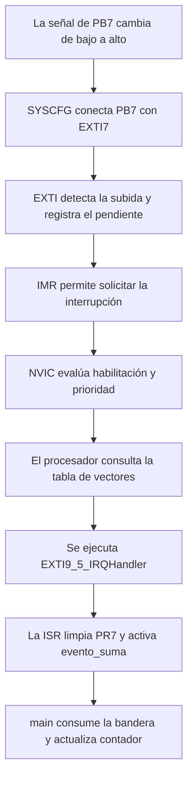

# Interrupciones, NVIC, EXTI y registros en nuestro STM32F411RE

**Proyecto:** First_task_TallerV  
**Fecha:** 19 de octubre de 2026  
**Programa de referencia:** [Core/Src/main.c](Core/Src/main.c)

Esta guía acompaña al [informe del proyecto](INFORME_PROYECTO.md). Aquí vamos a seguir el camino de una interrupción, desde el cambio en una fotocompuerta hasta la rutina que ejecuta el procesador. Después relacionaremos cada paso con sus registros.

El orden sigue los temas de las presentaciones del profesor **Nerio Andrés Montoya**: interrupciones, NVIC, prioridades, temporizadores, EXTI y máquinas de estados. También retoma la explicación de estructuras de C y registros de función especial. Las páginas de referencia aparecen al final.

## 1. Qué es una interrupción

Imagina que estás haciendo una tarea y suena una alarma. Atiendes lo que ocurrió y después continúas con tu trabajo. Una interrupción permite un comportamiento parecido dentro del microcontrolador.

En nuestro programa, el procesador suele estar recorriendo el `while (1)` de `main()`. Mientras tanto, los periféricos trabajan: un temporizador cuenta y una fotocompuerta puede cambiar su señal. Cuando una fuente habilitada solicita atención y las prioridades lo permiten, el procesador suspende temporalmente lo que estaba ejecutando y atiende una función específica.

Esa función se llama **ISR**, por *Interrupt Service Routine*, o rutina de servicio de interrupción. Al terminar, el procesador puede continuar el trabajo que había suspendido. Si hay otra solicitud pendiente y puede atenderse, también puede pasar a ella antes de regresar al programa principal.

Una interrupción no reinicia el programa ni vuelve a comenzar `main()`.

### Por qué nos sirve

Sin EXTI podríamos consultar constantemente el nivel del pin del sensor desde el ciclo principal. Esa técnica se llama *polling* o sondeo. Con EXTI, el hardware detecta el flanco seleccionado y solicita atención.

En este proyecto combinamos las dos ideas: el hardware detecta los cambios de los sensores y `main()` consulta las **banderas de software** que dejan sus ISR. El ciclo principal no está leyendo continuamente los pines para detectar flancos.

### Las cuatro fuentes de nuestro programa

| Fuente | Suceso que solicita atención | Trabajo de la ISR |
|---|---|---|
| PB7 mediante EXTI7 | Flanco de subida | Activar `evento_suma` |
| PA1 mediante EXTI1 | Flanco de bajada | Activar `evento_resta` |
| TIM5 | Update cada 1 ms | Avanzar un turno del display |
| TIM10 | Update cada 250 ms | Alternar PH1 |

Las fotocompuertas producen eventos asociados al exterior. Los temporizadores generan solicitudes desde periféricos internos. Las cuatro fuentes llegan al NVIC; las solicitudes de estos dos temporizadores no pasan por EXTI.

## 2. Las palabras que conviene separar

| Término | Significado aplicado al proyecto |
|---|---|
| Evento físico | Un objeto modifica la luz que recibe el sensor |
| Flanco | La señal eléctrica pasa de bajo a alto o de alto a bajo |
| IRQ | Solicitud de interrupción, *Interrupt Request* |
| ISR o handler | Función que atiende una solicitud aceptada |
| EXTI | Controlador de interrupciones y eventos externos del STM32 |
| NVIC | Controlador de interrupciones del núcleo Cortex-M4 |
| IVT o tabla de vectores | Tabla con las direcciones de las rutinas de atención |
| Bandera de software | Variable que nuestra ISR utiliza para dejar un aviso a `main()` |
| FSM | Máquina de estados finitos; organiza acciones y transiciones |

**EXTI y NVIC son bloques de hardware.** Las llamadas `NVIC_EnableIRQ()` y `NVIC_SetPriority()` son funciones de CMSIS que permiten configurarlo. `exti_Init()` es una función de inicialización escrita para nuestro proyecto. Las funciones cuyo nombre termina en `IRQHandler` son nuestras ISR.

## 3. El recorrido completo de la fotocompuerta de suma



Los bloques ya se configuraron durante la inicialización; el cambio de señal recorre ese circuito preparado. La acción final de sumar se realiza en `main()`, después de la atención de la interrupción.

La resta sigue un recorrido equivalente, con PA1, EXTI1, un flanco de bajada y `EXTI1_IRQHandler()`.

## 4. Cómo sabe el procesador a qué función entrar

El archivo [startup_stm32f411xx.S](Core/Src/startup_stm32f411xx.S) contiene la tabla de vectores. En ella hay entradas como:

```asm
.word EXTI1_IRQHandler
.word EXTI9_5_IRQHandler
.word TIM1_UP_TIM10_IRQHandler
.word TIM5_IRQHandler
```

Estas entradas están en posiciones específicas de la tabla; aquí se muestran agrupadas solamente para reconocer sus nombres.

Cuando se acepta una IRQ, el procesador utiliza la entrada correspondiente para encontrar la dirección de la ISR. El código de arranque declara rutinas débiles que nuestra aplicación sustituye al definir las funciones con sus nombres correctos.

Por eso no basta con escribir una función de nombre parecido. `EXTI9_5_IRQHandler` debe coincidir con el símbolo previsto en el archivo de arranque y debe quedar disponible para el enlazador.

### IRQn, línea EXTI y pin son números diferentes

En las cabeceras de este STM32 aparecen estos identificadores:

| Fuente | Línea o periférico | Identificador del NVIC | Número IRQn |
|---|---|---|---|
| PA1 | EXTI1 | `EXTI1_IRQn` | 7 |
| PB7 | EXTI7 | `EXTI9_5_IRQn` | 23 |
| Blinky | TIM10 | `TIM1_UP_TIM10_IRQn` | 25 |
| Display | TIM5 | `TIM5_IRQn` | 50 |

El 7 de PB7 identifica el pin y la línea EXTI7. Su IRQn es 23 porque las líneas EXTI5 a EXTI9 comparten una entrada del NVIC.

La tabla de vectores también contiene entradas del núcleo anteriores a las IRQ de periféricos. Por eso IRQn y posición dentro de la tabla tampoco son el mismo número.

## 5. Qué se guarda al entrar y qué ocurre al volver

Las diapositivas llaman a esta idea **guardar y restaurar contexto**, y la ilustran con *push* y *pop*.

El contexto incluye información necesaria para continuar la ejecución, como la posición del programa y registros del procesador. Cortex-M4 realiza automáticamente parte del guardado y de la restauración al entrar y salir de una excepción; el código generado por el compilador completa lo necesario para la función.

En estas ISR escritas en C no tenemos que programar manualmente instrucciones `push` y `pop`. Tampoco las llamamos desde `main()` para que respondan a un suceso físico: la entrada se produce mediante el mecanismo de interrupciones.

El guardado del contexto no guarda una copia de todas las variables globales. Si la ISR modifica una bandera, ese cambio sigue presente cuando regresa al programa interrumpido.

## 6. Qué hace el NVIC

NVIC significa *Nested Vectored Interrupt Controller*. Dentro del Cortex-M4 gestiona la habilitación, el estado pendiente, el estado activo y la prioridad de las IRQ de periféricos. Las funciones CMSIS dan acceso a esas operaciones; la [documentación de Arm sobre NVIC](https://arm-software.github.io/CMSIS_5/Core/html/group__NVIC__gr.html) reúne su interfaz.

### Las tres funciones que sí usamos

| Función | Qué hace | Ejemplo real |
|---|---|---|
| `NVIC_SetPriority(irq, prioridad)` | Configura la prioridad | `NVIC_SetPriority(EXTI1_IRQn, 2U)` |
| `NVIC_EnableIRQ(irq)` | Habilita la atención de esa IRQ | `NVIC_EnableIRQ(EXTI9_5_IRQn)` |
| `NVIC_DisableIRQ(irq)` | Deshabilita la atención de esa IRQ | `NVIC_DisableIRQ(TIM5_IRQn)` |

`NVIC_EnableIRQ()` no configura el pin ni selecciona el flanco. La configuración de la fuente debe estar preparada también.

`NVIC_DisableIRQ()` tampoco detiene el periférico ni borra sus pendientes. En nuestro caso, TIM5 puede seguir contando mientras su atención está deshabilitada; al volver a habilitarla, una solicitud pendiente puede atenderse enseguida.

### Otras funciones útiles para estudiar o depurar

Estas funciones de CMSIS **no forman parte del código actual**:

| Función | Consulta o acción |
|---|---|
| `NVIC_GetEnableIRQ()` | Consultar si una IRQ está habilitada |
| `NVIC_GetPendingIRQ()` | Consultar el pendiente del NVIC |
| `NVIC_GetActive()` | Consultar si una interrupción está activa, incluso si quedó suspendida por otra |
| `NVIC_GetPriority()` | Leer la prioridad configurada |
| `NVIC_ClearPendingIRQ()` | Borrar el pendiente del NVIC |

La implementación de estas funciones puede leerse en `core_cm4.h` del paquete CMSIS instalado. Son accesos al hardware definidos para el núcleo, compatibles con nuestro trabajo mediante registros.

## 7. Prioridades, preemption y tail chaining

En el STM32F411 se implementan cuatro bits de prioridad, indicados por `__NVIC_PRIO_BITS = 4`. Las funciones CMSIS reciben valores lógicos de 0 a 15 y los colocan en los bits implementados del registro de prioridad.

**Un número menor representa mayor urgencia.** En nuestro programa:

| IRQ | Prioridad configurada |
|---|---|
| EXTI1, resta | 2 |
| EXTI9_5, suma | 2 |
| TIM10, blinky | 3 |
| TIM5, display | 3 |

El programa no cambia la agrupación de prioridades del arranque. Con esta configuración, las IRQ de los sensores pueden interrumpir la atención de un temporizador. Dos IRQ con la misma prioridad de preemption esperan a que termine la que está ejecutándose; no se interrumpen mutuamente.

### Preemption: atender algo más urgente

Es el caso de la presentación en el que una rutina se suspende para atender otra de mayor prioridad:

```text
main → ISR de TIM5 → ISR de PB7 → continúa ISR de TIM5 → main
       prioridad 3   prioridad 2
```

Aunque las dos interrupciones estén activas durante parte de ese recorrido, el núcleo ejecuta instrucciones de una sola rutina en cada instante.

### Tail chaining: atender la siguiente antes de volver

Si al terminar una ISR hay otra solicitud pendiente que puede ejecutarse, Cortex-M puede pasar directamente a la siguiente atención, evitando una restauración y un nuevo guardado completos del contexto del programa principal.

```text
main → ISR A → ISR B pendiente → main
```

Esto ayuda a entender por qué no siempre se vuelve a `main()` entre dos ISR, como muestran las gráficas de las diapositivas.

Una ISR larga retrasa a las solicitudes de igual o menor prioridad de preemption. Las de mayor prioridad pueden interrumpirla si están habilitadas y no hay otro bloqueo que lo impida. Por eso conviene mantener corto el trabajo dentro de las rutinas.

### Agrupación de prioridades

`SCB->AIRCR`, mediante su campo `PRIGROUP`, permite repartir los bits entre prioridad de preemption y subprioridad. La primera decide si una ISR puede interrumpir otra; la segunda ayuda a ordenar pendientes del mismo grupo. El proyecto no llama a `NVIC_SetPriorityGrouping()` ni configura subprioridades por separado.

## 8. Antes de memorizar registros: qué es un SFR

La presentación de estructuras explica que un **Special Function Register** o SFR es una interfaz con hardware ubicada en una dirección de memoria.

Cuando escribimos:

```c
EXTI->RTSR |= EXTI_RTSR_TR7;
```

`EXTI` representa un puntero a la estructura de registros del periférico. `->RTSR` selecciona uno de sus campos y la máscara identifica el bit que se modifica. La escritura cambia la configuración física del detector de flanco.

No estamos creando un registro en RAM. Las cabeceras CMSIS ya describen dónde está el bloque de hardware y cómo acceder a sus campos. Sus registros se declaran con los calificadores de acceso correspondientes, que incluyen `volatile` para los accesos al periférico.

### Operaciones sobre los bits

| Expresión | Operación usual en un registro de lectura/escritura |
|---|---|
| `registro |= mascara` | Poner en uno los bits seleccionados |
| `registro &= ~mascara` | Poner en cero los bits seleccionados |
| `registro & mascara` | Consultar si alguno de esos bits está en uno |
| `registro ^= mascara` | Alternar los bits seleccionados |

Estas expresiones requieren conocer el comportamiento del registro. Un registro de pendientes puede borrarse escribiendo uno o escribiendo cero, según el periférico. En esos casos se utiliza la escritura que indica su definición, no una regla general de «siempre usar `|=`».

## 9. RCC y GPIO: preparar el acceso y el pin

### Registros de reloj y reset

| Registro | Bits utilizados en este proyecto | Propósito |
|---|---|---|
| `RCC->AHB1ENR` | `GPIOAEN`, `GPIOBEN`, `GPIOCEN`, `GPIODEN`, `GPIOHEN` | Habilitar relojes de los puertos |
| `RCC->APB2ENR` | `SYSCFGEN`, `TIM10EN` | Habilitar SYSCFG y TIM10 |
| `RCC->APB1ENR` | `TIM5EN` | Habilitar TIM5 |
| `RCC->APB2RSTR` | `TIM10RST` | Reiniciar la configuración de TIM10 |
| `RCC->APB1RSTR` | `TIM5RST` | Reiniciar la configuración de TIM5 |

Por ejemplo, antes de utilizar SYSCFG se ejecuta:

```c
RCC->APB2ENR |= RCC_APB2ENR_SYSCFGEN;
(void)RCC->APB2ENR;
```

La segunda línea hace una lectura de espera antes del acceso al periférico. Para el reset de los temporizadores se activa el bit correspondiente y luego se libera.

EXTI no necesita una habilitación de reloj separada en nuestro código. El reloj que activamos al inicio de `exti_Init()` es el de **SYSCFG**.

### Registros de los pines de las fotocompuertas

| Registro | Qué significa aquí |
|---|---|
| `GPIOx->MODER` | Dos bits por pin; `00` selecciona entrada |
| `GPIOx->PUPDR` | Dos bits por pin; `00` deja sin pull-up ni pull-down internos |
| `GPIOx->IDR` | Permite leer el nivel digital actual del pin |

PB7 y PA1 se dejan como entradas sin resistencias internas porque el montaje ya tiene polarización externa. `IDR` permitiría consultar su nivel en una prueba o en el depurador, pero las ISR actuales comprueban los pendientes de EXTI. Un bit de `IDR` informa un nivel lógico, no una medición del voltaje en voltios.

Para las salidas también aparecen `OTYPER`, `OSPEEDR` y `ODR`: configuran el tipo de salida, la velocidad de sus flancos y el nivel de salida. En la clase se presenta además `BSRR`, que permite poner o borrar bits de salida con una sola escritura. Nuestro programa conserva las operaciones sobre `ODR`; esta guía no modifica esa implementación.

## 10. SYSCFG: elegir qué puerto llega a cada línea EXTI

El número de pin y la línea EXTI se corresponden: PA1 puede conectarse a EXTI1 y PB7 a EXTI7. Lo que debemos seleccionar es el **puerto**.

PA7, PB7 y PC7 compiten por la misma línea EXTI7; no se pueden seleccionar simultáneamente como fuentes GPIO de esa línea. Nuestras entradas PA1 y PB7 usan números distintos y disponen de líneas diferentes.

Los registros se agrupan de cuatro líneas en cuatro:

| Nombre del manual | Acceso CMSIS | Líneas que selecciona |
|---|---|---|
| SYSCFG_EXTICR1 | `SYSCFG->EXTICR[0]` | EXTI0 a EXTI3 |
| SYSCFG_EXTICR2 | `SYSCFG->EXTICR[1]` | EXTI4 a EXTI7 |
| SYSCFG_EXTICR3 | `SYSCFG->EXTICR[2]` | EXTI8 a EXTI11 |
| SYSCFG_EXTICR4 | `SYSCFG->EXTICR[3]` | EXTI12 a EXTI15 |

Cada selección ocupa cuatro bits. En nuestro caso:

| Entrada | Campo | Bits del registro | Código de puerto |
|---|---|---|---|
| PA1 | EXTI1 de `EXTICR[0]` | 7:4 | `0000`, puerto A |
| PB7 | EXTI7 de `EXTICR[1]` | 15:12 | `0001`, puerto B |

Primero se limpia el campo y después se selecciona su puerto. En PA1, seleccionar A deja esos cuatro bits en cero.

## 11. Los registros de EXTI, uno por uno

| Registro | Nombre | Qué hace |
|---|---|---|
| `EXTI->RTSR` | Rising Trigger Selection Register | Selecciona detección por subida |
| `EXTI->FTSR` | Falling Trigger Selection Register | Selecciona detección por bajada |
| `EXTI->IMR` | Interrupt Mask Register | Permite o bloquea la solicitud de interrupción de una línea |
| `EXTI->EMR` | Event Mask Register | Habilita la vía de eventos; no se utiliza para estas entradas |
| `EXTI->PR` | Pending Register | Registra pendientes y permite borrarlos |
| `EXTI->SWIER` | Software Interrupt Event Register | Permite provocar una solicitud por software; no se usa aquí |

### RTSR y FTSR: cuándo detectar

El bit 7 se relaciona con EXTI7 y el bit 1 con EXTI1. La configuración actual es:

| Línea | RTSR | FTSR | Resultado |
|---|---|---|---|
| EXTI7, PB7 | Bit 7 en 1 | Bit 7 en 0 | Solo subida para sumar |
| EXTI1, PA1 | Bit 1 en 0 | Bit 1 en 1 | Solo bajada para restar |

```text
Subida:  ____|‾‾‾‾    (0 → 1)
Bajada:  ‾‾‾‾|____    (1 → 0)
```

La transición de subida es `0 → 1`; la de bajada es `1 → 0`. Que ocurra al tapar o al liberar la luz depende del circuito del sensor. Mantener un nivel alto o bajo no constituye un nuevo flanco.

En las pruebas iniciales estaban habilitadas ambas transiciones para observar los sensores. Después se eligió subida en suma y bajada en resta para evitar contar también la transición opuesta.

### IMR: dejar pasar la solicitud

Aunque el registro se llama de máscara, poner su bit en **uno** permite solicitar la interrupción; en cero la enmascara.

```c
EXTI->IMR |= (EXTI_IMR_MR7 | EXTI_IMR_MR1);
```

Esta habilitación y la del NVIC son controles diferentes. En nuestro programa deben estar preparadas las dos.

### PR: saber qué ocurrió y reconocerlo

Las rutinas consultan el bit correspondiente para comprobar el origen. En el vector compartido de suma se hace:

```c
if (EXTI->PR & EXTI_PR_PR7)
{
	EXTI->PR = EXTI_PR_PR7;
	evento_suma = 1U;
}
```

`PR7` se limpia escribiendo **uno** en ese bit. Escribir cero en los demás conserva sus pendientes. Por eso se asigna directamente la máscara y no se utiliza `|=`, que leería otros pendientes y podría escribir unos que también los borrasen.

Reconocer el evento no cambia el voltaje de PB7. Solamente retira el pendiente registrado para poder seguir atendiendo solicitudes posteriores.

### Líneas y vectores compartidos

| Líneas GPIO de EXTI | Rutina de atención |
|---|---|
| EXTI0 a EXTI4 | Una rutina por línea: `EXTI0_IRQHandler()` a `EXTI4_IRQHandler()` |
| EXTI5 a EXTI9 | `EXTI9_5_IRQHandler()` |
| EXTI10 a EXTI15 | `EXTI15_10_IRQHandler()` |

Una entrada de la tabla conduce a una ISR, pero esa ISR puede tener que revisar varias fuentes. Así encaja el concepto de «un handler por vector» de la clase con el caso real de las líneas compartidas.

## 12. Qué registros toca el NVIC por dentro

La implementación CMSIS instalada utiliza los siguientes campos. Se presentan para entender las funciones; no es necesario reemplazarlas por accesos manuales.

| Campo CMSIS | Nombre habitual | Función |
|---|---|---|
| `NVIC->ISER[]` | Interrupt Set-Enable Registers | Escribir 1 habilita una IRQ |
| `NVIC->ICER[]` | Interrupt Clear-Enable Registers | Escribir 1 deshabilita una IRQ |
| `NVIC->ISPR[]` | Interrupt Set-Pending Registers | Permite consultar o establecer pendientes |
| `NVIC->ICPR[]` | Interrupt Clear-Pending Registers | Escribir 1 borra el pendiente seleccionado |
| `NVIC->IABR[]` | Interrupt Active Bit Registers | Indica interrupciones activas |
| `NVIC->IP[]` | Interrupt Priority Registers, IPR | Contiene prioridades; CMSIS lo presenta como campos de un byte |

Las habilitaciones y pendientes se agrupan en palabras de 32 bits. Para `TIM5_IRQn = 50`, CMSIS selecciona la palabra 1 y el bit 18, porque `50 = 32 + 18`. Por tanto, `NVIC_EnableIRQ(TIM5_IRQn)` escribe su máscara en `ISER[1]`.

Para `EXTI9_5_IRQn = 23`, se utiliza la palabra 0 y el bit 23. Estos bits representan números IRQ, no números de pin GPIO.

`NVIC_SetPriority()` desplaza el valor según `__NVIC_PRIO_BITS`. Al llamar con prioridad 3, la implementación para este dispositivo coloca `0x30` en el campo correspondiente. Se pasa **3**, sin desplazarlo manualmente.

### Dos registros relacionados del núcleo

| Registro | Relación con las interrupciones | Uso actual |
|---|---|---|
| `SCB->VTOR` | Indica la dirección base de la tabla de vectores | El proyecto conserva la ubicación prevista en el arranque |
| `SCB->AIRCR` | Contiene `PRIGROUP`, agrupación de prioridades | No lo modificamos desde la aplicación |

Además existe `PRIMASK`, un registro especial del núcleo. `__disable_irq()` lo utiliza para bloquear globalmente la atención de interrupciones de prioridad configurable y `__enable_irq()` revierte ese bloqueo. No es equivalente a bloquear una sola IRQ. Nuestro programa emplea `NVIC_DisableIRQ(TIM5_IRQn)` para proteger la publicación del display sin bloquear los sensores.

## 13. Los registros de interrupción de los temporizadores

La diapositiva de configuración del timer muestra la cadena reloj, `CEN`, `PSC`, `CNT`, `ARR`, `UIF` y `UIE`. En nuestro código esa cadena se concreta así:

| Registro | Campo o contenido | Papel en el programa |
|---|---|---|
| `TIMx->CR1` | `CEN` | Pone en marcha o detiene el conteo |
| `TIMx->CR1` | `ARPE` | Habilita la precarga de ARR |
| `TIMx->PSC` | Prescalador | Divide el reloj del temporizador |
| `TIMx->CNT` | Contador actual | Conserva el avance de la cuenta |
| `TIMx->ARR` | Valor de recarga | Define el límite del conteo ascendente empleado |
| `TIMx->EGR` | `UG` | Genera un update por software para cargar la configuración inicial |
| `TIMx->DIER` | `UIE` | Permite que un update solicite una interrupción |
| `TIMx->SR` | `UIF` | Indica el update pendiente de reconocimiento |

`UIE` es un **permiso** y `UIF` es un **estado**. Poner UIE en uno no significa que ya haya ocurrido un update.

Con la configuración actual de reloj y conteo:

```text
TIM10: 16 MHz / (1600 × 2500) = 4 updates/s → uno cada 250 ms
TIM5:  16 MHz / (1600 ×   10) = 1000 updates/s → uno cada 1 ms
```

El código carga PSC y ARR, genera `UG`, limpia los estados de inicialización, habilita UIE y el NVIC y finalmente activa CEN. Esto evita tratar la carga inicial de los registros como si fuera el primer intervalo normal ya transcurrido.

En `TIM5_IRQHandler()` se reconoce UIF y se avanza el display:

```c
if (TIM5->SR & TIM_SR_UIF)
{
	TIM5->SR = ~TIM_SR_UIF;
	display_Actualizar();
}
```

En estos registros de estado de los timers, UIF se limpia escribiendo **cero**, y escribir uno conserva las otras banderas implementadas. Es un comportamiento distinto del pendiente de EXTI.

| Estado que queremos limpiar | Escritura usada |
|---|---|
| Pendiente EXTI7 | `EXTI->PR = EXTI_PR_PR7` |
| Update de TIM5 | `TIM5->SR = ~TIM_SR_UIF` |

Los nombres de las ISR también pueden ser compartidos: TIM10 utiliza `TIM1_UP_TIM10_IRQHandler()`. El proyecto comprueba TIM10 y no habilita TIM1.

## 14. Tres pendientes que no debemos confundir

Para la fotocompuerta de suma hay tres lugares con funciones distintas:

| Lugar | Qué representa | Cómo se reconoce o consume |
|---|---|---|
| `EXTI->PR`, bit 7 | El detector registró un evento en EXTI7 | Escribir 1 en PR7 |
| Estado pendiente del NVIC | La IRQ compartida solicita atención del núcleo | El NVIC gestiona el paso de pendiente a activa al aceptar la IRQ; CMSIS también permite borrar un pendiente |
| `evento_suma` en RAM | Nuestra ISR dejó trabajo para `main()` | `main()` asigna cero al consumir el aviso |

`NVIC_ClearPendingIRQ()` actúa sobre el segundo lugar y **no sustituye el reconocimiento de la fuente** en EXTI o en el timer. Si la fuente continúa solicitando atención, puede volver a quedar pendiente.

Del mismo modo, `evento_suma = 0U` solo consume la bandera de software; no configura EXTI ni limpia su registro PR.

Un bit pendiente conserva un estado, no una cantidad ilimitada de sucesos. La misma limitación se aplica a nuestras banderas de uno o cero: varios eventos próximos pueden agruparse antes de su atención. `volatile` hace visibles los accesos necesarios a memoria, pero no crea una cola ni vuelve indivisible el conjunto de consulta y borrado.

## 15. Relación con las máquinas de estados de la clase

La presentación propone un patrón fácil de seguir: la ISR deja una bandera y el ciclo principal ejecuta el trabajo asociado. Nuestras fotocompuertas siguen ese patrón:

```text
ISR del sensor → bandera → main → contador → cifras preparadas
```

El display tiene una FSM con cuatro estados: D1, D2, D3 y D4. En la implementación actual, **esa FSM se ejecuta directamente desde la ISR de TIM5**, no desde `main()`. Cada atención realiza un turno corto: apagar posiciones, escribir segmentos y activar una cifra.

Esta es una diferencia concreta respecto al ejemplo de FSM diferida al ciclo principal. Conviene reconocerla al explicar el proyecto: los sensores difieren su trabajo mediante banderas y TIM5 ejecuta directamente el refresco periódico. No se cambió esa arquitectura al escribir este documento.

## 16. Leer nuestra configuración como una secuencia

Si recorres `exti_Init()`, puedes traducirla a estas decisiones:

1. Dar reloj a SYSCFG para seleccionar las conexiones.
2. Enmascarar temporalmente EXTI1 y EXTI7 mientras se configuran.
3. Conectar PA1 con EXTI1 y PB7 con EXTI7.
4. Elegir bajada en PA1 y subida en PB7, deshabilitando los flancos opuestos.
5. Dejar sin utilizar la vía de eventos EMR.
6. Limpiar pendientes anteriores de esas líneas.
7. Permitir las solicitudes mediante IMR.
8. Configurar prioridades y habilitar sus IRQ en el NVIC.

Después, cada ISR comprueba su fuente, reconoce el pendiente y deja el aviso para el ciclo principal. Los temporizadores siguen una idea semejante, con sus propios permisos y banderas: UIE y UIF.

Para estudiar una línea de código, estas cuatro preguntas ayudan: **¿a qué bloque pertenece el registro?, ¿qué bit estoy tocando?, ¿estoy dando un permiso o consultando un estado?, ¿cómo se reconoce ese estado cuando ya lo atendí?**

## Material utilizado y páginas para repasar

Las páginas siguientes se cuentan según el PDF completo, incluyendo portadas y separadores. Algunas diapositivas llevan otra numeración impresa.

| Presentación del profesor | Páginas PDF | Temas retomados |
|---|---|---|
| [06-Interrupts_2026-02.pdf](</home/nomad/Descargas/presentaciones tallerV/06-Interrupts_2026-02.pdf>) | 4–6 | Definición de interrupción, IRQ, ISR e IVT |
| La misma presentación | 8–14 | NVIC, contexto, prioridades, tail chaining y preemption |
| La misma presentación | 16–18 | Temporizadores y cadena CEN–PSC–CNT–ARR–UIF–UIE |
| La misma presentación | 20–21 | EXTI, selección de puerto y flancos |
| La misma presentación | 23–26 | FSM y patrón ISR–bandera–ciclo principal |
| [05-IntroStructures_2026-02.pdf](</home/nomad/Descargas/presentaciones tallerV/05-IntroStructures_2026-02.pdf>) | 6, 8–10 y 13–20 | Punteros, SFR, estructuras de registros, GPIO y operaciones de bits |
| [IntroCLanguage_2026-02.pdf](</home/nomad/Descargas/presentaciones tallerV/IntroCLanguage_2026-02.pdf>) | 20–25 | Programa en C, tipos y operadores como base de lectura |

Las asignaciones, rutinas y valores del proyecto se comprobaron en [main.c](Core/Src/main.c), en su [tabla de vectores](Core/Src/startup_stm32f411xx.S) y en las cabeceras locales `stm32f411xe.h`, `core_cm4.h` y `cmsis_gcc.h` del paquete STM32Cube_FW_F4_V1.28.0.

Como consulta adicional están la [referencia de funciones NVIC de Arm CMSIS](https://arm-software.github.io/CMSIS_5/Core/html/group__NVIC__gr.html) y el [manual RM0383 del STM32F411 de STMicroelectronics](https://www.st.com/resource/en/reference_manual/dm00119316.pdf). Las presentaciones proporcionan el recorrido de clase; las cabeceras y el manual permiten relacionarlo con los nombres concretos del dispositivo.
