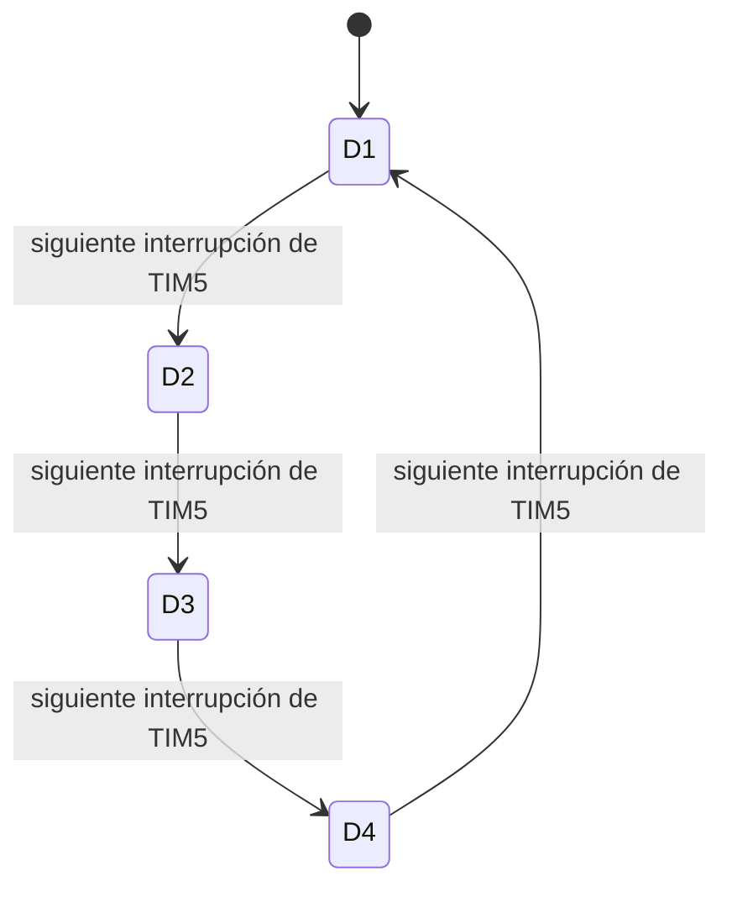

# Contador con fotocompuertas y display de cuatro cifras

**Proyecto:** First_task_TallerV  
**Microcontrolador:** STM32F411RE  
**Fecha del informe:** 19 de octubre de 2026  
**Código explicado:** [Core/Src/main.c](Core/Src/main.c)

Este proyecto cuenta los eventos de dos fotocompuertas y muestra el resultado en un display de siete segmentos de cuatro cifras. Una entrada solicita sumar y la otra restar. Mientras tanto, un LED parpadea de manera independiente para indicar actividad del programa.

El recorrido para entenderlo es sencillo: **el sensor avisa, el programa cambia el contador y el display presenta el resultado**. Los temporizadores se encargan de que el parpadeo y la visualización mantengan su ritmo sin introducir esperas en el ciclo principal.

## 1. Qué hace la versión actual

| Elemento | Funcionamiento configurado |
|---|---|
| Fotocompuerta de suma | PB7, únicamente por flanco de subida |
| Fotocompuerta de resta | PA1, únicamente por flanco de bajada |
| Contador | De 0 a 9999, con retorno circular en ambos extremos |
| Presentación | Cuatro cifras, con ceros a la izquierda |
| Barrido del display | TIM5, un turno cada 1 ms |
| LED de actividad | PH1, cambia de nivel cada 250 ms mediante TIM10 |

Por ejemplo, si el valor es 23, se prepara `0023`. Al sumar desde `9999`, el resultado vuelve a `0000`. Al restar desde `0000`, pasa a `9999`.

Las cuatro posiciones permanecen habilitadas en el programa, incluida D1. Aunque el montaje presentó un problema en el primer dígito, se decidió conservar el funcionamiento completo para probar posteriormente con otro display.

## 2. El montaje que debe corresponder al código

La referencia válida es el cableado corregido durante las pruebas. Las primeras asignaciones se ajustaron después de encontrar diferencias en las conexiones de la placa adaptadora.

### Segmentos

```text
       A
      ───
   F │   │ B
      ───  G
   E │   │ C
      ───
       D
```

| Segmento | Posición | GPIO |
|---|---|---|
| A | Horizontal superior | PB12 |
| B | Vertical superior derecha | PA12 |
| C | Vertical inferior derecha | PC11 |
| D | Horizontal inferior | PC12 |
| E | Vertical inferior izquierda | PC10 |
| F | Vertical superior izquierda | PA11 |
| G | Horizontal central | PD2 |

El punto decimal quedó sin conectar. En particular, la asignación vigente es **B = PA12 y F = PA11**.

### Selección de las cifras

Las posiciones se leen de izquierda a derecha:

| Dígito | Posición decimal | GPIO de control del transistor |
|---|---|---|
| D1 | Millares | PC5 |
| D2 | Centenas | PC6 |
| D3 | Decenas | PC2 |
| D4 | Unidades | PC3 |

El montaje utiliza un display de **ánodo común**, alimentación nominal de **3,3 V**, resistencias de **214 Ω** para los segmentos y una resistencia de **1 kΩ** en la base de cada transistor PNP 2N3906.

En este circuito, el emisor de cada transistor va a la alimentación, el colector alimenta el ánodo común de su dígito y la base se controla desde el GPIO mediante la resistencia. La identificación del 2N3906 como PNP puede consultarse en la [hoja de datos de onsemi](https://www.onsemi.com/pdf/datasheet/2n3906-d.pdf).

La lógica utilizada por el programa es:

| Salida | Nivel alto | Nivel bajo |
|---|---|---|
| GPIO de un segmento | Lo apaga | Permite encenderlo en el dígito seleccionado |
| GPIO de selección de dígito | Apaga su transistor | Activa su transistor |

Para que se vea un segmento deben coincidir dos condiciones: que esté seleccionado su dígito y que su línea de segmento esté en bajo.

Las fotocompuertas tienen polarización externa con resistencias de 10 kΩ. Por eso PB7 y PA1 se configuran sin resistencias internas de pull-up ni pull-down.

## 3. Cómo se reparte el trabajo

La aplicación está concentrada en `main.c`, con funciones privadas para organizar cada tarea. Se mantuvo el trabajo en C y el acceso directo a registros mediante CMSIS, siguiendo el estilo de los proyectos de clase.

| Función | Responsabilidad |
|---|---|
| `main()` | Inicializar el sistema y procesar los avisos de los sensores |
| `gpio_Init()` | Configurar entradas, salidas y niveles iniciales |
| `timers_Init()` | Configurar TIM10 y TIM5 |
| `exti_Init()` | Asociar los GPIO con EXTI y seleccionar sus flancos |
| `display_DrawNumber()` | Separar el número completo en cuatro cifras |
| `display_Escribir()` | Preparar los siete segmentos para una cifra |
| `display_Actualizar()` | Ejecutar un turno de la máquina de estados del display |
| `EXTI9_5_IRQHandler()` | Atender el evento de PB7 y dejar el aviso de suma |
| `EXTI1_IRQHandler()` | Atender el evento de PA1 y dejar el aviso de resta |
| `TIM5_IRQHandler()` | Solicitar el siguiente turno del display |
| `TIM1_UP_TIM10_IRQHandler()` | Alternar el LED de PH1 |

El nombre `timers_Init()` quedó en plural porque inicializa más de un temporizador. TIM10 tiene una tarea dedicada al blinky; TIM5 atiende el display.

## 4. Del encendido a `main()`

El archivo [startup_stm32f411xx.S](Core/Src/startup_stm32f411xx.S) contiene el arranque y la tabla de vectores. Antes de llegar a `main()`, llama a `SystemInit()`, prepara las variables en RAM y ejecuta la inicialización del entorno de C.

El proyecto incorpora la implementación oficial de `SystemInit()` mediante [CMakeLists.txt](CMakeLists.txt). En esta aplicación se conserva el reloj HSI de arranque de 16 MHz, sin habilitar PLL ni cambiar los divisores de los buses. Los cálculos de los temporizadores dependen de esa configuración.

También se mantiene HSE apagado para utilizar PH1 como salida del LED, según la configuración prevista para este montaje.

Dentro de `main()`, el orden es:

```c
gpio_Init();
display_Escribir(0U);
display_DrawNumber(contador);
timers_Init();
exti_Init();
```

Primero se dejan preparadas las conexiones y las cifras. Después se ponen en marcha los temporizadores y las interrupciones de los sensores. Cuando se prepara inicialmente el patrón de cero, los cuatro dígitos todavía están apagados.

Al terminar la inicialización, el programa permanece en `while (1)`. No utiliza retardos bloqueantes para esperar ni para multiplexar.

## 5. Las variables: avisos, valor y cifras

Durante el desarrollo surgió una duda importante: había nombres muy parecidos y parecía que se repetían los contadores. La versión actual conserva tres responsabilidades distintas.

### Las banderas avisan de un evento

```c
volatile uint32_t evento_suma = 0U;
volatile uint32_t evento_resta = 0U;
```

Una bandera funciona como una nota pendiente. La interrupción escribe `1` para avisar y `main()` escribe `0` al consumir el aviso.

Se usa `volatile` porque una interrupción puede cambiar estas variables fuera del flujo normal de `main()`. El compilador debe realizar los accesos a memoria correspondientes; no debe suponer que el valor permanece igual entre consultas.

**Una bandera no lleva la cantidad de interrupciones recibidas.** Si se escriben varios avisos antes de que `main()` los consuma, la bandera sigue valiendo `1`. Tampoco `volatile` convierte la consulta y el borrado en una única operación indivisible. Este diseño se mantuvo por su sencillez y por su relación con el ejemplo de clase; no garantiza registrar todos los pulsos a cualquier velocidad.

### El contador conserva el resultado

```c
uint32_t contador = 0U;
```

Esta es la variable que interesa observar en el depurador. Las interrupciones de los sensores no la modifican directamente: solo lo hace `main()` al procesar las banderas. Por eso no necesita `volatile` en la implementación actual.

Los contadores auxiliares de prueba que tenían nombres en plural se retiraron. No eran necesarios para almacenar el valor que se presenta en el display.

### El arreglo prepara la presentación

```c
static volatile uint32_t cifras_display[4] = {0U, 0U, 0U, 0U};
```

Aquí se guarda una cifra por posición: millares, centenas, decenas y unidades. Si `contador` vale 1234, el arreglo contiene `{1, 2, 3, 4}`.

`static`, aplicado a esta variable a nivel de archivo, limita su acceso a `main.c`. `volatile` refleja que `main()` escribe las cifras y la interrupción de TIM5 las consulta.

## 6. `gpio_Init()`: dejar preparado el circuito

La función empieza habilitando los relojes de GPIOA, GPIOB, GPIOC, GPIOD y GPIOH mediante `RCC->AHB1ENR`.

Después configura los pines con los registros que aparecen repetidamente en el código:

| Registro | Qué configura en este programa |
|---|---|
| `MODER` | Entrada o salida; cada pin ocupa dos bits |
| `OTYPER` | Salidas de tipo push-pull |
| `OSPEEDR` | Velocidad de los flancos de salida |
| `PUPDR` | Ausencia de resistencias internas en los pines utilizados |
| `ODR` | Nivel que entrega cada salida |

La velocidad configurada en `OSPEEDR` no define la frecuencia de parpadeo ni la de multiplexación. Esas frecuencias las determinan los temporizadores.

Una precaución del arranque consiste en poner primero en alto los controles de los cuatro transistores y luego configurar sus GPIO como salidas. Así se prepara el estado apagado antes de habilitar el manejo del display.

Para modificar un pin se preservan los demás bits del puerto. Por ejemplo:

```c
GPIOC->ODR |= GPIO_ODR_OD5;       /* PC5 alto: apagar D1. */
GPIOC->ODR &= ~(GPIO_ODR_OD5);    /* PC5 bajo: activar D1. */
GPIOH->ODR ^= GPIO_ODR_OD1;       /* Alternar PH1. */
```

`|=` coloca bits en uno, `&= ~` los limpia y `^=` los alterna. Esta forma de trabajar es especialmente importante en GPIOC, donde conviven líneas de segmentos y de selección de cifras.

## 7. Las fotocompuertas y EXTI

Una interrupción externa permite que un cambio eléctrico solicite atención del procesador. La configuración se realiza en `exti_Init()` y sigue este recorrido:

```text
Pin GPIO → selección de puerto en SYSCFG → detector de flanco EXTI → NVIC → rutina de atención
```

El número del pin determina la línea EXTI: PB7 utiliza EXTI7 y PA1 utiliza EXTI1. `SYSCFG->EXTICR` selecciona qué puerto alimenta cada una de esas líneas.

Para PB7 se usa `EXTICR[1]`, que corresponde al registro EXTICR2. Para PA1 se usa `EXTICR[0]`, correspondiente a EXTICR1. El índice del arreglo comienza en cero.

La selección final de flancos es:

```c
EXTI->FTSR &= ~(EXTI_FTSR_TR7); /* Desactivar bajada en PB7. */
EXTI->RTSR &= ~(EXTI_RTSR_TR1); /* Desactivar subida en PA1. */
EXTI->RTSR |= EXTI_RTSR_TR7;    /* Sumar por subida en PB7. */
EXTI->FTSR |= EXTI_FTSR_TR1;    /* Restar por bajada en PA1. */
```

Esto reemplazó la configuración de prueba que habilitaba ambos flancos y podía producir un aviso al tapar y otro al destapar.

La elección se refiere al **nivel eléctrico**: PB7 cuenta una transición de bajo a alto y PA1 una de alto a bajo. Que ese cambio ocurra al tapar o al liberar la luz depende del circuito del sensor.

La función también limpia solicitudes pendientes, habilita las líneas en `IMR` y permite sus interrupciones en el NVIC. `EMR` queda deshabilitado para estas líneas porque se utiliza el mecanismo de interrupciones.

### Qué hace cada rutina de atención

La suma entra por `EXTI9_5_IRQHandler()`, un vector compartido con otras líneas. Por eso la rutina comprueba específicamente `PR7`. La resta utiliza `EXTI1_IRQHandler()` y comprueba `PR1`.

Ambas rutinas hacen poco trabajo: limpian su pendiente y activan la bandera correspondiente. Por ejemplo:

```c
EXTI->PR = EXTI_PR_PR7;
evento_suma = 1U;
```

En `EXTI->PR` el pendiente se limpia escribiendo **uno**. Se usa asignación directa de la máscara para evitar borrar accidentalmente otros pendientes que podrían aparecer al leer el registro mediante `|=`.

## 8. El conteo circular dentro de `main()`

Cuando `evento_suma` vale uno, el programa consume el aviso y decide:

```c
if (contador < 9999U)
{
	contador++;
}
else
{
	contador = 0U;
}
```

La resta aplica la decisión complementaria: si el valor es mayor que cero, disminuye; si ya es cero, se asigna `9999U`.

| Operación | Resultado |
|---|---|
| 0000 + 1 | 0001 |
| 0099 + 1 | 0100 |
| 9999 + 1 | 0000 |
| 0100 − 1 | 0099 |
| 0001 − 1 | 0000 |
| 0000 − 1 | 9999 |

El retorno se programa explícitamente. Si se decrementara un `uint32_t` igual a cero, el desbordamiento natural del tipo produciría 4294967295, que queda fuera de las cuatro cifras. La aplicación necesita volver a 9999.

Se usan dos `if` independientes para las banderas. Si ambas están pendientes al consultarlas, primero se procesa la suma y después la resta; con el rango circular, esas dos operaciones se compensan.

Después de cada cambio se llama a `display_DrawNumber(contador)` para publicar la nueva presentación.

## 9. Las tres funciones del display

Cada función resuelve una parte distinta del problema. Separarlas permite entender qué número se quiere mostrar, qué segmentos necesita una cifra y qué posición está encendida.

### `display_DrawNumber()`: separar el número

Esta función recibe el valor completo y prepara sus cuatro cifras:

```c
cifras_display[0] = numero / 1000U;
cifras_display[1] = (numero / 100U) % 10U;
cifras_display[2] = (numero / 10U) % 10U;
cifras_display[3] = numero % 10U;
```

La división entera descarta la parte decimal y `% 10` conserva la última cifra del resultado.

| Número | D1 | D2 | D3 | D4 |
|---|---|---|---|---|
| 0 | 0 | 0 | 0 | 0 |
| 23 | 0 | 0 | 2 | 3 |
| 508 | 0 | 5 | 0 | 8 |
| 1234 | 1 | 2 | 3 | 4 |

La función acepta valores entre cero y 9999. Si recibe un valor mayor, conserva el arreglo anterior. No escribe GPIO ni selecciona transistores: prepara los datos que usará el barrido.

### `display_Escribir()`: formar una cifra

Recibe una sola cifra de cero a nueve. Primero apaga las siete líneas de segmentos y después, mediante un `switch`, pone en bajo las que necesita.

| Cifra | Segmentos encendidos |
|---|---|
| 0 | A, B, C, D, E, F |
| 1 | B, C |
| 2 | A, B, D, E, G |
| 3 | A, B, C, D, G |
| 4 | B, C, F, G |
| 5 | A, C, D, F, G |
| 6 | A, C, D, E, F, G |
| 7 | A, B, C |
| 8 | A, B, C, D, E, F, G |
| 9 | A, B, C, D, F, G |

Si el argumento no corresponde a una cifra válida, todos los segmentos quedan apagados. La función conserva los bits de selección de dígitos: solo modifica A–G.

### `display_Actualizar()`: elegir dónde se ve la cifra

Esta función coordina la multiplexación. Como las cuatro posiciones comparten las líneas A–G, se enciende una posición por turno.

En cada llamada se realiza la misma secuencia:

1. Apagar los cuatro dígitos.
2. Preparar el patrón de segmentos de la posición elegida.
3. Habilitar únicamente su transistor.
4. Guardar cuál será el próximo estado.

Apagar las posiciones antes de cambiar el patrón reduce la aparición de segmentos que pertenecen al turno anterior.

## 10. La máquina de estados del display

La máquina ya forma parte del programa: no es una ampliación pendiente.

| Estado | Posición activa | Dato utilizado | Siguiente estado |
|---|---|---|---|
| 0 | D1, PC5 | Millares | 1 |
| 1 | D2, PC6 | Centenas | 2 |
| 2 | D3, PC2 | Decenas | 3 |
| 3 | D4, PC3 | Unidades | 0 |



`estado_display` es una variable local `static`: conserva su valor entre llamadas a la función. Sin esa persistencia, el barrido volvería siempre al primer turno.

La función también conserva un arreglo local `cifras_en_uso`. Al comenzar D1 copia las cuatro cifras preparadas y utiliza esa misma copia durante todo el recorrido. Si `main()` cambia el contador a mitad del barrido, la nueva versión se toma al iniciar el siguiente recorrido.

El caso `default` permite recuperar el estado cero y deja los dígitos apagados durante esa llamada si apareciera un estado inválido.

## 11. TIM10 y TIM5: dos ritmos independientes

La función `timers_Init()` configura ambos periféricos. Con la configuración de reloj actual, los dos reciben 16 MHz.

Para el conteo ascendente empleado aquí:

```text
Frecuencia de update = reloj del timer / ((PSC + 1) × (ARR + 1))
Periodo de update    = ((PSC + 1) × (ARR + 1)) / reloj del timer
```

Se suma uno porque el prescalador y el registro de recarga codifican sus cantidades de esa manera. Con `ARR = 9`, por ejemplo, el contador recorre diez valores: del cero al nueve.

| Parámetro | TIM10: blinky | TIM5: display |
|---|---|---|
| Bus | APB2 | APB1 |
| Reloj usado en el cálculo | 16 MHz | 16 MHz |
| PSC | 1599 | 1599 |
| Frecuencia después de PSC | 10 000 Hz | 10 000 Hz |
| ARR | 2499 | 9 |
| Periodo de update | 250 ms | 1 ms |
| Rutina | `TIM1_UP_TIM10_IRQHandler()` | `TIM5_IRQHandler()` |

### El blinky de TIM10

```text
Periodo = (1600 × 2500) / 16 000 000 = 0,25 s
```

Cada interrupción alterna PH1 mediante XOR. Hay un cambio cada 250 ms, por lo que un ciclo completo de encendido y apagado tarda 500 ms: dos ciclos por segundo.

El vector se llama `TIM1_UP_TIM10_IRQHandler()` porque es compartido con el update de TIM1. En este proyecto se utiliza TIM10 y se comprueba su propia bandera.

El blinky confirma que su temporizador y su interrupción siguen siendo atendidos. Como funciona desde una ISR, por sí solo no demuestra que el ciclo principal esté procesando correctamente los sensores.

### El barrido de TIM5

```text
Periodo de turno = (1600 × 10) / 16 000 000 = 0,001 s
Recorrido de cuatro cifras = 4 × 1 ms = 4 ms
Refresco de cada posición = 1 / 0,004 s = 250 Hz
```

Aunque el turno cambia a 1 kHz, cada cifra se selecciona una vez cada cuatro turnos. Su fracción de tiempo encendida es aproximadamente del 25 %, descontando los pequeños intervalos de cambio y los retrasos de atención de interrupciones.

Durante la conversación hablamos de PWM para conmutar el display. **La implementación actual utiliza interrupciones periódicas y escritura de GPIO para multiplexar.** No se configura un canal de salida PWM mediante registros como `CCMR`, `CCER` o `CCR`. Esta distinción ayuda a explicar con precisión qué hace TIM5 en el programa entregado.

### La secuencia de configuración de los timers

El código habilita el reloj del periférico, aplica su reset, prepara PSC y ARR y habilita `ARPE`, la precarga de ARR. Luego genera `UG` en `EGR` para cargar la configuración inicial, limpia `SR`, habilita `UIE` en `DIER`, configura el NVIC y activa `CEN`.

Durante el funcionamiento, las ISR comprueban `UIF` y lo limpian con:

```c
TIM5->SR = ~TIM_SR_UIF;
```

Aquí se escribe **cero** en UIF para limpiarlo, preservando las demás banderas implementadas mediante unos. Conviene recordar la diferencia con `EXTI->PR`, que se limpia escribiendo uno: el método depende del registro.

## 12. Cómo se evita mezclar dos números

Hay dos medidas que se complementan.

Al preparar el arreglo desde `main()`, se deshabilita brevemente la interrupción de TIM5:

```c
NVIC_DisableIRQ(TIM5_IRQn);
display_DrawNumber(contador);
NVIC_EnableIRQ(TIM5_IRQn);
```

Así, la ISR no puede tomar una copia mientras se están escribiendo las cuatro posiciones. Se bloquea la atención de esa interrupción, no el funcionamiento del contador del temporizador; tampoco se bloquean las interrupciones de las fotocompuertas.

Por otro lado, la copia `cifras_en_uso` mantiene el mismo número durante un recorrido completo. La primera medida protege la publicación y la segunda conserva la coherencia visual entre turnos.

Los sensores tienen prioridad numérica 2 y los temporizadores prioridad 3. Con la configuración de prioridades utilizada, las solicitudes de los sensores tienen mayor urgencia. Mantener cortas sus ISR ayuda a que el refresco del display y el blinky continúen con regularidad.

## 13. Qué nos enseñaron las pruebas del montaje

El desarrollo se hizo por etapas: primero el blinky, luego las entradas de las fotocompuertas y finalmente la presentación multiplexada. Separar esas tareas permitió comprobar cada parte antes de integrarla.

Durante la conexión del display se corrigieron D, E y G, además del orden de D3 y D4. También se revisó la asignación entre PA11 y PA12; el código final conserva F en PA11 y B en PA12.

Cuando las primeras posiciones mostraron segmentos incompletos y dos dígitos parecían encender juntos, se preparó una prueba con ochos y turnos de 500 ms. Después se dejó D1 fijo para facilitar mediciones. Estas pruebas ya se retiraron del programa actual.

Se identificó un transistor marcado 3904 donde debía instalarse un 3906. El usuario lo sustituyó. Más adelante, intercambiar transistores no resolvió el problema restante del primer dígito.

En la medición se informó aproximadamente 3,24 V entre GND y el emisor. También se comunicó una lectura de 1,6 V RMS entre GND y el colector; quedó pendiente confirmarla en continua y completar las mediciones de base y control.

Por tanto, **la causa definitiva de la falla de D1 no quedó demostrada**. Se planteó la posibilidad de un problema del propio display y se decidió probar con otro. Las cuatro posiciones permanecen activas para esa comprobación.

## 14. Verificación y límites de esta versión

El usuario confirmó en el montaje el funcionamiento de las fotocompuertas y, posteriormente, del conteo con retorno circular y del refresco restaurado. La modificación más reciente seleccionó subida para PB7 y bajada para PA1; se compiló sin advertencias, pero su comprobación física posterior no consta todavía en esta sesión.

Antes de ese último ajuste se ejecutaron comprobaciones de software sobre las funciones reales del conteo y la selección de cifras: 20 000 operaciones de suma/resta, 10 000 casos con ambas banderas pendientes y 40 000 turnos de multiplexación. Estas comprobaciones se hicieron mediante un programa temporal fuera del proyecto. Verifican lógica de software; no sustituyen la prueba del montaje.

Los límites que conviene tener presentes son concretos:

- Las banderas no forman una cola de eventos: varios pulsos próximos pueden perderse o agruparse antes de su procesamiento.
- Elegir un solo flanco elimina el conteo de la transición opuesta, pero no filtra cambios adicionales por ruido. No hay filtrado temporal ni validación de estabilidad implementados.
- Las frecuencias calculadas dependen de conservar el reloj de 16 MHz y los divisores actuales.
- El estado físico de D1 sigue pendiente de comprobación con otro display.
- No se implementó una salida UART ni impresión por consola; el valor puede observarse en el display y en el depurador.

Para observar `contador` en Watch, debe haberse cargado el ejecutable Debug con sus símbolos y estar en una sesión de depuración activa. Si aparece `not available`, conviene detener la ejecución y comprobar que se está depurando el ejecutable de este proyecto.

## 15. Una forma cómoda de recorrer el código

Para estudiar el programa, conviene empezar por `main()` y seguir un evento completo:

```text
Subida en PB7
    → EXTI7 solicita atención
    → EXTI9_5_IRQHandler() activa evento_suma
    → main() consume el aviso y actualiza contador
    → display_DrawNumber() prepara las cuatro cifras
    → TIM5_IRQHandler() llama a display_Actualizar()
    → display_Escribir() coloca el patrón y se selecciona un dígito
```

Ese último recorrido se repite periódicamente aunque no llegue ningún objeto nuevo. En paralelo, TIM10 sigue alternando PH1 cada 250 ms.

Así se relacionan las piezas del proyecto: **el contador conserva la cantidad, el arreglo conserva su presentación decimal y la máquina de estados decide qué cifra se muestra en cada instante**.

## Referencias para continuar el estudio

La explicación de la implementación corresponde al [código actual](Core/Src/main.c), al [archivo de arranque](Core/Src/startup_stm32f411xx.S) y a la configuración de [CMake](CMakeLists.txt). Las convenciones se tomaron del archivo `CODESTYLE.md` indicado durante la sesión, ubicado en `/home/nomad/github/stm32-course-dcorread/ai-config`.

Para ampliar la consulta de los registros puede utilizarse el [manual oficial RM0383 de STMicroelectronics](https://www.st.com/resource/en/reference_manual/dm00119316.pdf), especialmente sus capítulos de RCC, GPIO, SYSCFG, EXTI y temporizadores. Para identificar el transistor y su encapsulado, está disponible la [hoja de datos del 2N3906 de onsemi](https://www.onsemi.com/pdf/datasheet/2n3906-d.pdf).
